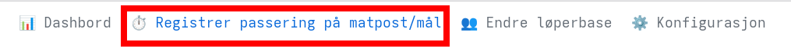
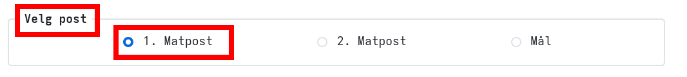
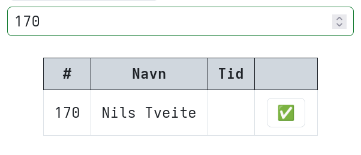
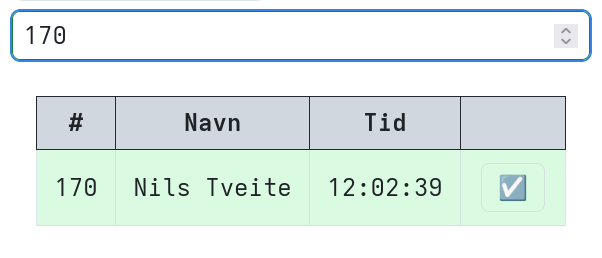
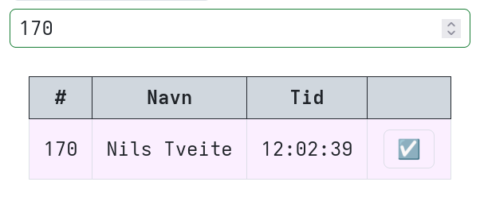
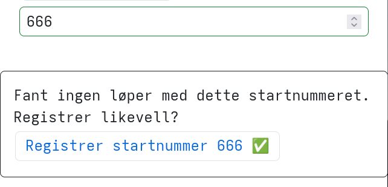

% Bruksinstruks Elektronisk Kadaver Tidtakningssystem (EKT)

# Registrere passeringer
Gå til [ekt.trygve.net/admin/](https://ekt.trygve.net/admin/)

Blir du bedt om å logge inn skriver du inn et navn (vilkårlig, kun for å vite hvem som har endret hva) og passordet du fikk av løpsleder.

Skal du registrere passeringer trykker du på denne knappen:

Det første du må gjøre er å velge hvilken matpost du står på. Husk å bytte dette hvis du flytter til en annen matpost/mål

Når en løper skal registreres skriver du inn startnummeret. Løperens navn skal da dukke opp og du trykker på ✅️

Etter løperen har passert matposten blir bakgrunnen grønn:

Har løperen passert en senere matpost eller mål blir bakgrunnen lilla.

Har det skjedd en feil og startnummeret ikke ligger i systemet får du valget å registrere den likevell. Tida blir lagra, men vill ikke dukke opp i resultatlista før løperen blir registrert i databasen. Det er derfor lurt å spørre løperen om hva han/hun heter og skrive det ned.

# Legge til info om løpere

Velg `👥 Løperbase` fra menyen og bla ned til "Legg til løper". Skriv inn minimum startnummer og navn og trykk `Legg til løper`

# Se eller endre løperinfo
Velg `👥 Løperbase` fra menyen og finn "Søk opp løper". Søk opp løperen (og trykk på riktig om det dukker opp flere). Her ser du hva løperen registrerte i nettskjema inkludert telefonnummer om de må kontaktes. Trykker du på `✏️ Endre løper` kan du endre på infoen.

# Nedtelling på matpost

`⏳️ Nedtelling 1. mat` og `⏳️ Nedtelling 2. mat` viser en overskt over hvem som nettop har ankommet matpost og hvor lang tid de har igjen. Alle må vente minste 4 minutt før de kan løpe videre. Denne skjermen er nyttig å ha på en pc eller pad.

# Konfigurasjon

Under `⚙️ Konfigurasjon` kan du endre visse instillinger

Etter startskuddet er gått bør starttidspunktet justeres slik at tidene blir nøyaktige. Dette påvirker ikke registrering på matpostene eller mål siden de bare lagrer klokkeslett.

"Vis startnummer i påmeldtlista" skrus på når startnummer er fordelt slik at løperne kan se det før de møter på Eika sportsenter.

"Skjul resultattabellene på forsiden" gjemmer liveresultatene. Nyttig før løpet når man tester systemet.

"Skjul løpere som ikke har startet" kan skrus på når man har huket av alle som har starta slik de som ikke møtte opp fjernes.

# Hvordan funker det bak kullisene?

All dataen er lagra i tekstfiler. 

db.csv har alle løperene og passering.csv har alle registreringene gjort på matpost og i mål. php koden kverner dette og spytter ut resultatlister og diverse.

Når du registrerer en løper vil en ny linje bli lagt til i passering.csv. Registrerer du eller noen andre samme person på samme matpost igjen vil den siste registreringa gjelde. Det betyr i praksis at det ikke er mulig å gjøre noe galt siden ingenting blir skrevet over eller sletta. Trykker man feil blir i verste fall en mellomtid feil og dette kan enkelt rettes opp i etter løpet.